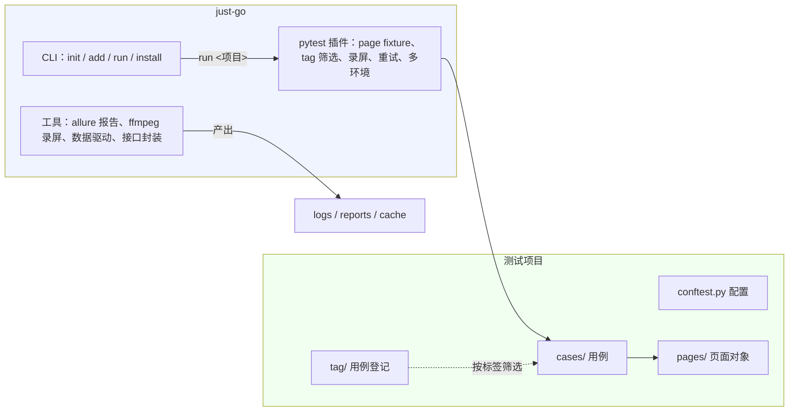

# just-go

只需要专注业务编写的一个分离式 **Web 自动化测试框架**。

> 测试项目单独存放、互不影响。升级框架、迁移机器、接入 CI，都不需要改动已写好的测试代码。

[](https://pypi.org/project/just-go/)
[](https://pypi.org/project/just-go/)
[](https://github.com/lu-xianseng/justgo/blob/main/LICENSE)
[](https://github.com/lu-xianseng/justgo/actions/workflows/test.yml)
[]()

---

## 设计理念

测试工程普遍面临三个痛点：**框架代码与用例代码耦合**（升级困难）、**重复劳动**（登录、录屏、报告、重试都要自己搭）、**筛选与报告粗糙**（用例多了之后无法精确挑选、结果难以追溯）。just-go 从这三个问题出发：



- **框架层**：安装后，随 PyPI 版本升级；
- **项目层**：`just-go init` 生成的标准骨架，测试代码与框架完全解耦；
- **产物层**：日志、Allure 报告、原始结果自动归置，也可重定向归档。

---

## 核心特性

| 特性 | 说明 |
| --- | --- |
| **框架分离** | 测试项目内不含框架源码，框架独立升级，项目之间互不影响 |
| **脚手架** | `just-go init` 生成 GUI / API / 全量骨架，基类下沉公共逻辑，用例只写业务 |
| **同步 / 异步** | `def` 与 `async def` 任意混用，框架自动路由，无需 pytest-asyncio |
| **浏览器兼容** | `config.run.browser_type` 切换 chromium / firefox / webkit，不改用例代码 |
| **登录态复用** | 登录一次保存 `storage_state`，跨用例免重复登录 |
| **多环境切换** | `--env dev/test/prod` 一键切换被测环境 |
| **自动重试** | 默认失败重试 1 次，`@pytest.mark.flaky` 单用例覆盖 |
| **tag 筛选** | 项目 `tag/` 目录 + CSV 登记，`--tag "L1 and smoke"` 表达式精确挑选 |
| **录屏** | 基于系统 ffmpeg 录屏（Windows  / Linux）自动附入报告 |
| **报告** | 开箱即用：HTML，含失败截图、录屏、日志、用例链接 |
| **数据驱动** | `just_go.data` 加载 JSON / CSV 数据，配合 `pytest.mark.parametrize` |
| **接口能力** | Request 提供上传/下载/自动重试/代理/Cookie 管理，模板 `BaseApi` 直接复用 |
| **文档日志** | `@log` 类装饰器：方法被调用时自动把 docstring 记为日志（支持 `{{参数}}` 占位符），页面对象封装操作一目了然 |
| **接口令牌** | `Request.set_token()` 注入全局请求头，接口用例免重复写鉴权头 |
| **产物重定向** | 默认输出在项目根，CI / 只读目录场景用 `--output` 重定向 |

---

## 快速开始

### 1. 安装框架

```bash
pip install just-go
just-go install          # 安装系统级工具：Chromium / allure / ffmpeg
```

> `install` 按需指定组件：`just-go install [playwright|allure|ffmpeg|all]`。
> Python 依赖（pytest/requests/allure 库等）由项目虚拟环境自动安装，不需要本命令处理。

### 2. 初始化测试项目

```bash
just-go init demo             # GUI 骨架：页面对象 + 页面用例（默认类型）
just-go init "demo[api]"      # API 骨架：接口封装 + 接口用例
just-go init "demo[all]"      # 两套都生成
```

生成**标准空白骨架**：目录结构、配置、开发指南齐全，业务代码按项目内 `README.md` 指引填充。

### 3. 配置被测地址

编辑测试项目 `conftest.py`（骨架已内置 `setup_env()` 调用，默认走 `dev`）：

```python
from just_go.core import setup_env

setup_env({
    "dev":  "http://192.168.1.10:8080",   # 必改：填入实际地址
    "test": "http://test.example.com",
    "prod": "https://www.example.com",
})
```

### 4. 注册并运行

```bash
just-go add demo D:\ProjectCode\demo   # 注册项目（名称自定）
just-go run demo                            # 执行全部用例
just-go run demo --env prod                 # 按环境切换被测地址
just-go run demo --tag "smoke and L1"       # 按 tag 表达式筛选
just-go run demo --collect-only             # 只收集用例，不执行
```

跑完打开项目根 `reports/<最新时间戳>/index.html` 查看报告，录屏、失败截图、日志都在里面。

报告默认为**单文件 HTML**（整个报告就是一个 `index.html`，方便归档/分享）、**中文界面**、**标题为被测项目名**（如 `reports/<时间戳>/index.html` 打开后标题显示 `AutoLib`）；如需自定义标题或语言，可在被测项目 `config.ini` 中配置 `report_name` / `report_language`（需 allure ≥ 2.30，框架安装默认即 2.30）。

---

## 用例编写

`page` 是框架提供的 fixture，conftest.py 自动包装成 `PageExport`（页面对象 + 断言统一出口）。
用例里直接调 `page.xxx()`，不需要手动 import 页面对象：

```python
from cases.case_base import CaseBase

class TestLogin(CaseBase):
    def test_login_1(self, page):
        """输入正确账号密码，登录系统"""
        page.input_account("admin")       # 页面对象方法
        page.input_password("password")
        page.submit()
        page.assert_visible(".welcome")   # UI 断言
        page.assert_equal("ok", resp["status"])  # 数据断言
```

同步用例 `def test_xxx(page)`，异步用例 `async def test_xxx(page)`（方法需 await）。

内置断言（PageExport 已合并 SyncAssert + AssertCommon，直接用）：

| 断言 | 说明 |
| --- | --- |
| `assert_equal(expect, actual)` | 相等 |
| `assert_in(expect, actual)` | 包含 |
| `assert_re_check_equal(pattern, text)` | 正则匹配 |
| `assert_visible(locator)` | 元素可见 |
| `assert_text(locator, expected)` | 元素文本 |

自定义异常体系（`from just_go.errors import JustGoError, RequestError, RecordError`）：

```python
try:
    ...
except JustGoError as e:   # 捕获所有框架自定义异常
    ...
```

## 页面对象（GUI）

`pages/base_page.py` 继承框架 `SyncWebUI` / `AsyncWebUI`，自动获得浏览器操作能力。
`pages/login_page.py` 按业务模块写页面对象（一个页面一个文件）。

新增页面对象步骤：
1. 在 `pages/` 下新建 `xxx_page.py`，写类继承 `BasePage`
2. 在 `pages/__init__.py` 的 `PageExport` 继承列表里加上新类

```python
# pages/login_page.py
class LoginPage(BasePage):
    _account_input = "#username"
    _submit_btn = "#submit"

    def input_account(self, account):
        """输入账号 {{account}}"""
        self.page.fill(self._account_input, account)

    def submit(self):
        """点击登录"""
        self.page.click(self._submit_btn)
```

`PageExport` 多继承所有页面对象 + 断言类，conftest.py 自动把 page fixture 包装成 PageExport。
用例里直接调 `page.input_account("admin")`，不需要手动 import。

---

## 接口封装（API）

`init [api]` 生成的骨架：`apis/base_api.py` 继承框架 `Request`，
`apis/user_manager_api.py` 按模块封装接口（一个模块一个文件），`apis/__init__.py` 统一导出。

`BaseApi` 继承 `Request` 自动获得全部 HTTP 能力，只额外提供基址拼接：

| 能力 | 说明 |
| --- | --- |
| `get/post/put/delete`、`upload_file`、`download` | 继承自框架 `Request`（session 复用、默认超时、异常统一） |
| `set_token` / `set_cookie` / `get_cookies` / `set_proxy` | 继承自框架 `Request` |
| `retry_times` / `retry_delay` | 构造参数：接口失败自动重试（默认关闭，幂等接口建议开启） |
| `base_url` / `_url(path)` | 本类新增：`JUSTGO_TEST_BASE_URL` 基址 + 拼接完整接口地址 |

```python
from .base_api import BaseApi

class UserManagerApi(BaseApi):
    def login(self, username, password):
        """登录：POST /api/login"""
        resp = self.post(self._url("/api/login"), json={"username": username, "password": password})
        return resp.json()

user_manager_api = UserManagerApi()
```

用例直接调接口 + 断言（不需要 page fixture）：

```python
from apis import user_manager_api

def test_login_1():
    data = user_manager_api.login("admin", "123456")
    assert data["code"] == 0
```

---

## 高级能力

### 多浏览器

`config.run.browser_type` 支持 `chromium` / `firefox` / `webkit`（默认 chromium），在项目 conftest.py 顶部切换，**不用改任何用例**：

```python
from just_go.core import config
config.run.browser_type = "firefox"   # 或 webkit
```

### 登录态复用

解决"每个用例都要登录"：登录一次保存状态，后续用例直接复用。

```python
# 1. 登录用例中保存（执行一次即可）：
page.context.storage_state(path="state.json")

# 2. 项目 conftest.py 声明复用：
config.run.storage_state = "state.json"   # 相对路径基于测试项目根
```

之后每个用例启动浏览器都会自动加载登录态；重新登录只需删除 `state.json` 再跑一次保存步骤。

### 多环境切换

骨架 conftest.py 内置 `setup_env({...})`（dev / test / prod），运行时指定环境：

```bash
just-go run demo --env prod    # 或直接在项目根: pytest --env prod
```

未指定时默认 `dev`。环境标识写入 `JUSTGO_ENV`，conftest 按它选择被测地址；增删环境只改 `BASE_URLS` 字典。

### 失败自动重试

骨架默认失败用例自动重试 1 次（间隔 1 秒）。单个用例单独控制：

```python
@pytest.mark.flaky(reruns=3, reruns_delay=2)
def test_unstable_1001(self, page):
    ...
```

全局关闭：把 `pytest.ini` 中的 `--reruns=1 --reruns-delay=1` 改为 `--reruns=0` 或删除。

### 数据驱动

把用例数据抽到 JSON / CSV 文件，配合 pytest 参数化：

```python
import pytest
from just_go.data import load_json_cases, load_csv_cases

@pytest.mark.parametrize("case", load_json_cases("login_cases.json"))
def test_login(case):
    data = login(case["username"], case["password"])
    assert data["code"] == 0
```

- JSON：顶层为数组，每项一组参数；
- CSV：首行为表头；
- 相对路径基于测试项目根解析。

### 接口令牌注入

登录拿到 token 后一键注入全局请求头，后续请求自动携带：

```python
from just_go.http import Request

api = Request()
api.set_token(token, prefix="Bearer ")          # Authorization: Bearer <token>
api.set_token(token, header_name="X-Token")     # 自定义请求头名
```

---

### 方法文档即日志（@log 类装饰器）

装饰在类上，该类（含父类）的公共方法**被调用时自动把方法文档记为日志**，对页面对象封装尤其有用——每个业务操作自动变成一条可读日志，Allure 报告里能看到完整操作轨迹。

```python
from just_go.core import log

@log
class HomePage(BasePage):
    def search(self, keyword):
        """搜索关键词：{{keyword}}"""
        self.page.fill(self._search_input, keyword)
        self.page.press(self._search_input, "Enter")

    def get_search_result(self):
        """获取搜索结果文本"""
        return self.get_text(self._search_result)
```

调用 `home.search("手机")` 时自动记录一条 INFO 日志 `搜索关键词：手机`——docstring 里的 `{{keyword}}` 会被替换成调用实参，日志同步进入控制台、日志文件与 Allure 报告。

约定（装饰器强制）：
- 类及父类的公共方法**必须写 docstring**，缺失直接抛 `TypeError` 提醒补文档，保证所有操作都有日志可查；
- `_` 开头的内部方法不记录日志，也不强制要求 docstring；
- 文档中可用 `{{参数名}}` 占位实际调用值，让日志带上关键数据（搜索词、订单号等）。

## 桌面录屏（ffmpeg）

- **开启**：`pytest.ini` 中 `--record=yes`（骨架默认开启，删除该行即关闭）；临时开关 `just-go run demo --record=no`
- **方式**：系统 ffmpeg 抓取整个桌面（Windows 用 `gdigrab`，Linux 用 `x11grab`），产出 mp4 自动附入 Allure 报告
- **依赖**：系统需已安装 ffmpeg 并加入 PATH

```bash
just-go install ffmpeg    # 自动安装（winget），装完新开终端刷新 PATH
```

---

## tag 用例筛选（可选）

不使用 tag 也能跑：项目没有 `tag/` 目录时，全部用例直接执行。需要筛选时：

**1. 建目录与登记表**（`just-go init` 骨架自带空表）：

```
tag/
└─ module.csv            # 一个用例模块一个 CSV，与 cases/<模块>/ 对应
```

**2. 登记用例**（固定 4 列）：

```csv
用例ID,用例级别,场景,跳过原因
1001,L1,登录,
1002,L2,订单,接口未就绪
```

- `用例ID` 与用例函数名 `test_<模块>_<用例ID>` 中的 ID 对应（如 `test_login_1001` ↔ `1001`）；
- `跳过原因` 填写后该用例自动跳过；
- 登记后即可按表达式筛选：

```bash
just-go run demo --tag "L1 and smoke"          # 逻辑与
just-go run demo --tag "L1 or L2"              # 逻辑或
just-go run demo --tag "(L1 or L2) and smoke"  # 括号组合
```

---

## 运行产物

默认输出在测试项目根下（CI / 只读目录场景可用 `just-go run demo --output <目录>` 重定向，按 输出根/项目名 分子目录，多项目互不干扰）：

```
demo/
├─ logs/           # 运行日志（loguru，每次运行一个时间戳文件，10MB 滚动保留 7 天）
├─ reports/        # Allure HTML 报告（每次运行一个时间戳目录，不覆盖历史）
└─ cache/          # Allure 原始结果（report/）、临时录屏与截图（temp/）
```

---

## 配置参考

### 框架级（`just_go/configs/config.ini`，一般不用改）

| 配置项 | 说明 |
| --- | --- |
| `framework.browser_path` | 指定浏览器可执行文件路径（默认 Playwright 自带 Chromium） |
| `framework.allure_path` | allure 工具路径（留空自动查找：PATH → `~/.just-go/allure/*/bin`） |
| `framework.report_name` / `report_language` | 报告标题（缺省=被测项目名）/ 语言（缺省 zh），allure ≥ 2.30 生效 |
| `framework.log_path` / `report_path` / `cache_path` | 产物目录名（默认 logs / reports / cache） |
| `run.slow_time` | 操作慢速等待毫秒数（默认 500） |
| `run.show_browser` | `True` 显示浏览器窗口 / `False` 无头运行 |
| `run.browser_type` | 浏览器类型：`chromium` / `firefox` / `webkit` |
| `run.storage_state` | 登录态文件路径（留空不启用，相对路径基于测试项目根） |

### 项目级（conftest.py / 命令行）

| 配置项 | 位置 | 说明 |
| --- | --- | --- |
| `setup_env({...})` + `JUSTGO_TEST_BASE_URL` | 项目 `conftest.py` | 被测系统地址（**必改**），写入报告环境信息 |
| `JUSTGO_TEST_CASE_BASE_URL` | 项目 `conftest.py` | 测试管理平台（如禅道）用例链接前缀（可选） |
| `--env <名称>` | `just-go run` / `pytest` | 运行环境（dev/test/prod），配合 `BASE_URLS` 切换 |
| `--record` | 项目 `pytest.ini` | 录屏开关（默认 yes） |
| `--reruns` | 项目 `pytest.ini` | 失败重试（默认 1），`@pytest.mark.flaky` 可单用例覆盖 |
| `--output <目录>` | `just-go run` | 产物输出根目录重定向 |
| `config.run.*` | 项目 `conftest.py` | 运行时覆盖框架配置，仅对本次运行生效 |

---

## 常用命令

| 命令 | 作用 |
| --- | --- |
| `just-go install [playwright\|allure\|ffmpeg\|all]` | 安装 / 检查系统级工具（默认 all） |
| `just-go init <目录[类型]>` | 初始化测试项目骨架（gui / api / all，默认 gui） |
| `just-go add <名称> <路径>` | 注册测试项目 |
| `just-go list` | 列出已注册项目（含路径有效性标记） |
| `just-go remove <名称>` | 取消注册 |
| `just-go run <名称\|路径> [pytest参数]` | 执行测试项目，其余参数透传 pytest（`--tag` / `--record` / `--env` / `--collect-only` 等）；**自动使用被测项目独立虚拟环境**（无则回退框架环境，兼容旧项目） |
| `just-go shell <名称\|路径>` | 进入被测项目的 pipenv 虚拟环境（首次自动创建并安装依赖） |
| `just-go version`（或 `just-go --version`） | 显示框架版本号（无需任何依赖，可直接执行） |

---

## 环境要求

- Python 3.10+
- 平台：Windows / Linux（Linux 桌面录屏需 X11 环境）
- 浏览器：`just-go install playwright` 自动安装 Chromium
- Allure 报告需 Java：`just-go install allure` 检测缺失会自动尝试安装（Windows 用 winget 装 Temurin JDK，Linux 用 apt 装 OpenJDK 17），装不了会给出手动下载指引
- ffmpeg：录屏必需，`just-go install ffmpeg` 自动安装（Windows winget / Linux apt），或手动下载加入 PATH

> **测试项目虚拟环境**：`just-go init` 生成骨架时自动创建项目级 pipenv 虚拟环境并安装依赖。
> GUI 项目自动包含 playwright，纯 API 项目不装 playwright。
> `just-go run` 自动检测并使用项目环境执行；项目额外依赖在环境内 `pipenv install <包名>`。

---

## 常见问题

**录屏没有产出 / 提示 ffmpeg 未安装？**
运行 `just-go install ffmpeg` 自动安装（winget），装完**新开终端**刷新 PATH 再跑。

**Allure 报告没生成？**
`just-go install allure` 安装报告工具（需要 Java，检测缺失会自动装 Temurin JDK）。报告生成依赖 allure 工具；即使未装，Allure 原始结果仍保留在 `cache/report/`。

**浏览器起不来 / 提示 playwright 相关错误？**
运行 `just-go install playwright` 安装 Chromium；若配置了 `framework.browser_path`，确认该路径的浏览器可执行文件存在；无头模式看不到窗口属正常（`config.run.show_browser`）。

**用例收集数量为 0？**
`just-go init` 生成的是空白脚手架，填充前收集到 0 个用例属正常。确认用例函数名以 `test_` 开头、位于 `testpaths`（默认 `cases/`）目录下。

**用例被自动跳过？**
检查对应 `tag/<模块>/<模块名>.csv` 的「跳过原因」列是否已填写。

**`--tag` 筛选不生效？**
`--tag` 依赖 `tag/` 目录与登记数据：确认 CSV 已登记该用例（用例ID 与函数名中 ID 一致），表达式不区分大小写，支持 `and` / `or` / 括号组合。

**想直接用 pytest 而不是 just-go run？**
可以。项目根 `conftest.py` 已声明框架插件，在项目根直接敲 `pytest` 即可，效果相同。

**导入 just_go 报 `SoftwareNotInstallError`？**
说明项目虚拟环境未创建或依赖未装全：在项目目录执行 `pipenv install`，或重新 `just-go init` 生成项目（自动创建环境）。

---

## 贡献与许可

- 问题与建议：GitHub Issues（[issues](https://github.com/lu-xianseng/justgo/issues)）
- 版本发布：打tag 触发 GitHub Actions + Trusted Publishing 自动构建发布到 PyPI
- License：MIT
