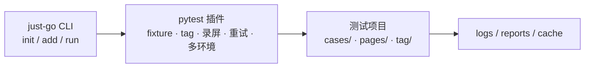

# just-go

一个**框架与测试代码彻底分离**的 Web 自动化测试框架，基于 pytest + Playwright。
GUI 页面对象与接口用例写在两个独立项目里，共用同一套断言、日志和报告。

> 升级框架、迁移机器、接入 CI，都不需要改动已写好的测试代码。

[](https://pypi.org/project/just-go/)
[](https://pypi.org/project/just-go/)
[](LICENSE)
[](https://github.com/lu-xianseng/justgo/actions/workflows/test.yml)

---

## 为什么用 just-go

| 常见痛点 | just-go 的做法 |
| --- | --- |
| 框架代码和用例混在一个仓库，升级靠复制粘贴 | 框架装进 site-packages，测试项目只有 `cases/` `pages/`；`pip install -U just-go` 即完成升级 |
| 登录、录屏、报告、重试、多环境，每个项目各写一遍 | 全部内置，项目里只留一份 `conftest.py` 地址配置 |
| 用例一多就无法精确挑选，失败原因要翻日志 | `--tag "L1 and smoke"` 表达式筛选；报告里失败截图、录屏、日志、用例链接同屏 |

---

## 30 秒看懂



写用例就是声明元素、调动作、加断言：

```python
class TestLogin(CaseBase):
    """登录模块用例"""

    def test_login_2346(self, page: PageExport):
        """输入正确账号密码，登录系统"""
        page.login_page.account.fill("admin")        # 元素动作，自动记日志
        page.login_page.password.fill("admin123")    # 密码自动脱敏
        page.login_page.login_btn.click()
        page.assert_visible(page.sidebar_page.start_page)

        r = page.api.get("/admin-api/task/page", params={"pageNo": 1})   # 复用登录态调接口
        r.assert_status(200)
        assert r.json()["code"] == 0
```

跑完的日志自带用例标识，报告里能看到每一步：

```
INFO | [2346] - 用例标题：输入正确账号密码，登录系统
INFO | [2346] - [登录页面] 账号输入框(account) 输入 "admin"
INFO | [2346] - [登录页面] 密码输入框(password) 输入 ***
INFO | [2346] - [登录页面] 登录按钮(login_btn) 点击
INFO | [2346] - 接口 GET /admin-api/task/page -> 200 (71ms)
```

---

## 核心能力

**工程结构**

| 能力 | 说明 |
| --- | --- |
| 框架分离 | 测试项目不含框架源码，框架独立升级，项目之间互不影响 |
| 一键脚手架 | `just-go init "demo[gui\|api\|all]"` 生成目录、配置、开发指南，并自动创建项目虚拟环境 |
| 项目级配置 | 需要改浏览器/工具路径或产物目录时，在项目根自建 `config.ini` 只写要改的项；其余配置写在 `conftest.py` |

**写用例**

| 能力 | 说明 |
| --- | --- |
| 元素声明 | `element(selector, "中文名")` 一行声明，调动作自动记日志 + Allure 步骤，敏感字段自动脱敏 |
| 页面对象分层 | 元素文件只写定位，业务文件只写动作组合；断言独立成类，可随时增加业务断言 |
| 同步 / 异步混用 | `def` 与 `async def` 可在同一项目任意混用，框架自动路由，无需 pytest-asyncio；模板默认只生成同步页面对象，异步用例直接用原生 page（见[用例怎么写](#用例怎么写)） |
| 同会话调接口 | `page.api` 复用浏览器 cookie 与鉴权头，GUI 用例里直接造数据 / 取数据 |
| 接口封装 | `BaseApi` 继承 `Request`，自带重试、上传下载、代理、Cookie、令牌注入 |

**跑用例**

| 能力 | 说明 |
| --- | --- |
| tag 筛选 | `--tag "L1 and smoke"`、`(L1 or L2) and 登录`，支持 `跳过原因` 自动跳过 |
| 多环境切换 | `--env dev/test/prod`，一处配置，命令行切换 |
| 登录态复用 | 登录一次保存 `storage_state`，跨用例免重复登录 |
| 失败重试 | 默认重试 1 次，`@pytest.mark.flaky` 可单用例覆盖 |
| 桌面录屏 | ffmpeg 抓屏，失败用例自动把视频附进报告 |
| 多浏览器 | `config.run.browser_type` 切换 chromium / firefox / webkit，不改用例 |

**看结果**

| 能力 | 说明 |
| --- | --- |
| Allure 报告 | 默认单文件 HTML + 中文界面，含失败截图、录屏、日志、禅道用例链接 |
| 日志带用例标识 | 每行前缀 `[用例ID]`，多个用例交错输出也能分清来源 |
| 产物自动归置 | `logs/` `reports/` `cache/`，CI / 只读目录可用 `--output` 重定向 |
| 屏幕找图 | OpenCV 模板匹配（可选依赖），覆盖 Playwright 够不到的桌面 / 像素场景 |

---

## 5 分钟跑通

### 1. 安装

```bash
pip install just-go
just-go install            # Chromium + allure + ffmpeg，按需可只装其一
```

```bash
just-go install playwright # 只装浏览器
just-go install allure     # 只装报告工具（缺 Java 会自动尝试安装）
just-go install ffmpeg     # 只装录屏编码器
```

### 2. 生成项目

```bash
just-go init demo              # GUI 骨架（默认）
just-go init "demo[api]"       # 接口骨架
just-go init "demo[all]"       # 两套都生成
```

生成后会自动创建项目级 pipenv 虚拟环境并安装依赖。机器上没有 pipenv 时会提示跳过。

### 3. 填被测地址

编辑 `demo/conftest.py`：

```python
from just_go.config import setup_env

setup_env({
    "dev":  "http://192.168.1.10:8080",   # 必改
    "test": "http://test.example.com",
    "prod": "https://www.example.com",
})
```

### 4. 运行

```bash
just-go add demo D:\ProjectCode\demo   # 注册（只需一次）
just-go run demo                       # 全部用例
just-go run demo --env prod            # 切换环境
just-go run demo --tag "smoke and L1"  # 按标签筛选
just-go run demo --record=no           # 临时关录屏
```

跑完打开 `demo/reports/<时间戳>/index.html`。

> 也可以不用 CLI：项目根已声明框架插件，直接 `pytest` 效果相同。

---

## 用例怎么写

`page` 是框架 fixture。默认返回原生 Playwright Page；项目 `conftest.py` 会把它包装成
`PageExport`（页面对象 + 断言统一出口），用例里直接 `page.<模块>_page.<元素>.<动作>`：

```python
# cases/login_manage/test_login_2346.py
from cases.case_base import CaseBase
from pages import PageExport


class TestLogin(CaseBase):
    """登录模块用例"""

    def test_login_2346(self, page: PageExport):
        """输入正确账号密码，登录系统"""
        page.login_page.account.fill("admin")
        page.login_page.password.fill("admin123")
        page.login_page.login_btn.click()
        page.assert_visible(page.sidebar_page.start_page)
```

命名约定：`test_<模块>_<用例ID>`，一个文件只放同 ID 的用例（`test_login_2346.py` ↔ 用例ID `2346`）。
框架在收集阶段校验，名字不符会直接报错，避免用例如"悄悄不执行"。

异步用例直接写 `async def`，框架会自动在事件循环里执行，不需要 pytest-asyncio。
但**模板生成的 `PageExport` 是同步包装**（继承 `BasePage` + `SyncAssert`），异步用例要用原生 page：

```python
async def test_login_2346(page):
    """异步用例：直接操作原生 page"""
    await page.goto("about:blank")
    await page.locator("[name='username']").fill("admin")
```

需要异步页面对象与断言时，在项目里另建一套（框架已提供 `AsyncBasePage` / `AsyncAssert`）：

```python
# pages/async_export.py
from just_go.asserts import AsyncAssert
from just_go.templates.gui.pages.base_page import AsyncBasePage   # 或复制进项目
from just_go.log import log

@log
class AsyncPageExport(AsyncBasePage):
    """异步页面对象 + 断言"""

    def __init__(self, page):
        super().__init__(page)
        self.asserts = AsyncAssert()

    async def assert_visible(self, locator, timeout=None):
        await self.asserts.assert_visible(locator, timeout=timeout)
```

```python
# conftest.py：按用例是否 async 选择 fixture
import inspect
import pytest

@pytest.fixture
def page(_pw_page, request):
    if inspect.iscoroutinefunction(request.node.obj):
        return AsyncPageExport(_pw_page)
    return PageExport(_pw_page)
```

> 同步与异步页面对象**不要混用**：把异步 page 传给同步 `PageExport` 时，页面对象的
> `page.api` 会降级为懒创建，其余 UI 方法需要 `await` 但返回的是同步调用，会报
> `TypeError: 'NoneType' object can't be awaited`。

### 内置断言

`PageExport.__getattr__` 把 `assert_` 前缀转发给 `pages/asserts/asserts.py` 的 `Asserts`，
所以 `page.assert_xxx(...)` 直接可用。断言可直接传 `Element` / selector 字符串。

| 数据断言 | 说明 |
| --- | --- |
| `assert_equal(expect, actual)` / `assert_not_equal` | 相等 / 不等 |
| `assert_in(expect, actual)` / `assert_not_in` | 包含 / 不包含 |
| `assert_true(actual)` / `assert_false(actual)` | 真 / 假 |
| `assert_re_check_equal(pattern, text)` / `assert_re_check_not_equal` | 正则命中 / 不命中 |

| UI 断言 | 说明 |
| --- | --- |
| `assert_visible(locator)` / `assert_hidden` | 可见 / 隐藏（`assert_hidden` 含「不存在」；只要存在但不可见用 `assert_not_visible`） |
| `assert_attached` / `assert_empty` / `assert_count(locator, n)` | 已挂载 DOM / 内容为空 / 匹配数量 |
| `assert_text(locator, expected)` / `assert_text_contains` | 文本相等 / 包含（支持正则、列表，可传 `ignore_case` / `use_inner_text`） |
| `assert_value` / `assert_values` | 输入值 / 多选值列表 |
| `assert_checked` / `assert_enabled` / `assert_disabled` / `assert_editable` / `assert_focused` | 勾选 / 可用 / 禁用 / 可编辑 / 焦点 |
| `assert_attribute(locator, name, value)` / `assert_id` / `assert_class` / `assert_class_contains` | 属性 / id / class 完全匹配 / class 包含 |
| `assert_url(page, expected)` / `assert_title(page, expected)` | 页面 URL / 标题（可直接传 PageExport） |
| `assert_image("btn")` / `assert_not_image("tip")` | 屏幕找图（需 `just-go[image]`） |

每个 UI 断言都在同一节里写着配套的反向断言 `assert_not_xxx`（如 `assert_not_text_contains` /
`assert_not_attribute`），走 Playwright 的自动等待重试，不要自己取文本再比较；它们是
`SyncAssert` / `AsyncAssert` 上的真实方法，IDE 里有补全、跳转和参数提示。日志风格与正向一致
（`元素不可见: <Element 元件库选中角标(...)>`）。`assert_not_checked` 等旧名字保持不变。

自定义断言：往 `Asserts` 里加 `assert_xxx` 方法即可；非 `assert_` 前缀用 `page.asserts.xxx(...)` 调用。

---

## 能力详解

### 元素声明：一行一个，动作自动记日志

```python
# pages/login_page/login_page_ele.py
from just_go.web import element

class LoginPageEle:                # 不需要继承任何基类
    """登录页面"""

    account = element("[name='username']", "账号输入框")
    password = element("[name='password']", "密码输入框", sensitive=True)
    login_btn = element("button:has-text('登录')", "登录按钮")
```

访问后直接调 Playwright 动作：

```
[登录页面] 账号输入框(account) 输入 "admin"
[登录页面] 密码输入框(password) 输入 ***
[登录页面] 登录按钮(login_btn) 点击
```

- 28 个动作自动记日志：`click` `dblclick` `fill` `type` `press` `check` `select_option` `hover` `drag_to` `set_input_files` `wait_for` `screenshot` 等
- 只读取值的方法（`inner_text` `count` `get_attribute` `is_visible`）直通原生 Locator，不记日志
- IDE 补全覆盖全部原生 `Locator` 方法：`Element` 在类型检查期以 `Locator` 为基类，`inner_text()` / `get_attribute()` / `bounding_box()` 等在链式调用后照样有提示和返回类型（运行时并不继承，仍是 `__getattr__` 转发）
- 链式定位 `first` `last` `nth` `filter` `locator` `get_by_*` `visible` `normalize` `describe` 返回包装后的 Element，日志能力不丢（`visible` 是属性，写成 `el.visible` 而不是 `el.visible()`）
- iframe：`el.frame_locator("iframe")` / `el.content_frame` 返回 `FrameElement`，只支持 `locator` / `get_by_*` 继续定位，不能直接 `.click()`——`FrameLocator` 本身没有动作方法
- 需要原生 Locator（比如传给 `expect`）用 `.native`
- `sensitive=True` 显示 `***`；属性名或描述含 `password` / `pwd` / `token` / `secret` / `密码` / `验证码` 也会自动脱敏

### 页面对象：元素与业务分离

```python
# pages/login_page/login_page.py
from just_go.log import log
from .login_page_ele import LoginPageEle

@log
class LoginPage(LoginPageEle):
    """登录页面对象"""

    def __init__(self, page):
        self.page = page          # 元素描述符从这里取 page

    def login(self, account, password):
        """登录：输入 {{account}} 后提交"""
        self.account.fill(account)
        self.password.fill(password)
        self.login_btn.click()
```

`@log` 把方法 docstring 记成业务级日志（`{{参数}}` 会替换成实参，密码类参数打码），
元素动作再各记一条，两层互补：

```
[登录页面对象] 登录：输入 admin 后提交
[登录页面对象] 账号输入框(account) 输入 "admin"
...
```

`@log` 强制类及父类的公共方法写 docstring，缺了直接抛 `TypeError`，保证每个操作都有日志可查。

新增页面：`pages/` 下建 `xxx_page/`，元素写 `xxx_page_ele.py`、业务写 `xxx_page.py`，
再到 `PageExport.__init__` 注册。断言不挂在继承链上，统一委托给 `Asserts`。

### GUI 用例里调接口：`page.api`

复用当前浏览器会话的 cookie 与登录态，用来造数据 / 取数据，不用手工拼 headers：

```python
r = page.api.get("/admin-api/task/page", params={"pageNo": 1})
r.assert_status(200)
rows = r.json()["data"]["list"]

page.api.post("/admin-api/upload", files={"file": ("a.txt", b"...", "text/plain")})
```

| 能力 | 说明 |
| --- | --- |
| 请求方法 | `get/post/put/patch/delete/request`，入参同 `Request`：`params` `json` `data` `files` `headers` `timeout` |
| 响应对象 | `status_code` `ok` `headers` `url`、`body()` `text` `json()`、`assert_status(*codes)` `assert_ok()` |
| 基址 | 相对路径按 `JUSTGO_TEST_BASE_URL` 解析，缺基址抛 `ConfigError` |
| 鉴权 | 自动沿用页面同源请求的 `Authorization` / `X-Access-Token` / `X-Token`；`set_token` / `set_headers` 后以调用方为准 |
| 超时 | 单位秒；`timeout=0` 表示不超时 |

`files=` 写法同 requests：路径、`bytes` 或 `(文件名, 内容[, MIME])`，内部转成 Playwright 的 `multipart`。

> 边界：走 context 级请求，不支持流式下载与请求级代理/证书。大文件下载用 `Request.download()`；
> 纯接口套件用 `apis/` 下的 `BaseApi`（不拉起浏览器）。

### 接口封装（API 项目）

`BaseApi` 继承框架 `Request`，只额外提供基址拼接：

```python
# apis/user_manager_api.py
from .base import BaseApi

class UserManagerApi(BaseApi):
    """用户管理接口封装"""

    def login(self, username, password):
        """登录：POST /api/login"""
        resp = self.post(self._url("/api/login"), json={"username": username, "password": password})
        return resp.json()

user_manager_api = UserManagerApi()
```

用例不需要 `page` fixture：

```python
from apis import user_manager_api

def test_login_1():
    """正确账号密码登录"""
    assert user_manager_api.login("admin", "123456")["code"] == 0
```

`Request` 自带：session 复用、默认 30s 超时、`retry_times` / `retry_delay` 失败重试、
`upload_file` / `download`、`set_token` / `set_cookie` / `get_cookies` / `set_proxy`，
异常统一转成 `RequestError`。

### 多环境切换

```python
# conftest.py
setup_env({"dev": "http://10.0.0.1", "test": "http://test.example.com"})
```

```bash
just-go run demo --env test
```

未指定时用 `dev`。环境标识写入 `JUSTGO_ENV`，地址写入 `JUSTGO_TEST_BASE_URL`；
你自己 export 的 `JUSTGO_TEST_BASE_URL` 优先级更高，不会被 `--env` 覆盖。

### 登录态复用

```python
# conftest.py
config.run.storage_state = "state.json"    # 相对路径基于项目根
```

```python
# 登录成功后保存一次
page.page.context.storage_state(path=config.run.storage_state)
```

之后每个用例启动浏览器都会自动加载该登录态。文件不存在时跳过加载（首次运行不会卡住），
登录态过期时删除文件重新登录即可。

### 失败自动重试

`pytest.ini` 默认 `--reruns=1 --reruns-delay=1`。单用例覆盖：

```python
@pytest.mark.flaky(reruns=3, reruns_delay=2)
def test_unstable_1001(self, page):
    ...
```

### 桌面录屏

- 开关：`pytest.ini` 的 `--record=yes`（骨架默认开启），临时关闭 `just-go run demo --record=no`
- 方式：ffmpeg 抓整个桌面（Windows `gdigrab` / Linux `x11grab`），仅失败用例的视频附入报告
- 依赖：`just-go install ffmpeg` 从 PyPI 取出内置二进制到 `~/.just-go/ffmpeg`，
  所有项目与虚拟环境共用，不需要系统预装，也不写进项目依赖

### 屏幕找图（可选）

```bash
pipenv install "just-go[image]"
```

```python
from just_go.image import find_image, wait_image

r = find_image("images/login_btn", similarity=0.9)   # 后缀可省略，相对路径基于项目根
if r:
    print(r.match.center, r.match.score)             # 真实屏幕坐标（多屏已含偏移）

r = wait_image("success_tip", timeout=10)            # 轮询，超时返回 found=False
r = find_image("btn", source=(0, 0, 800, 600))       # 只搜指定屏幕区域，更快
```

要点：`similarity` 默认 1.0，有缩放 / 抗锯齿时用 0.85~0.95；`source` 可传屏幕区域、
截图路径、`PIL.Image` 或无参可调用对象；首次截屏自动开启 Per-Monitor DPI 感知。
断言用 `page.assert_image("btn")` / `page.assert_not_image("tip")`。

### tag 用例筛选

不建 `tag/` 目录就全部执行，需要筛选时：

```csv
# tag/login_manage.csv
用例ID,用例级别,场景,跳过原因
2346,L1,登录,
2347,L2,下单,接口未就绪
```

```bash
just-go run demo --tag "L1"
just-go run demo --tag "L1 and smoke"
just-go run demo --tag "(L1 or L2) and 登录"
```

- CSV 路径对应用例目录：`cases/login_manage/` → `tag/login_manage.csv`（平铺，不是嵌套目录）
- 用例ID 与函数名 `test_<模块>_<用例ID>` 中的数字对应
- `跳过原因` 填了内容，该用例自动跳过
- ASCII 标签（`L1` / `smoke`）按完整标签匹配，`L1` 不会命中 `L10`；中文按包含匹配
- 登记了 tag 数据后，未登记的用例会被跳过并告警

### 数据驱动

```python
import pytest
from just_go.data import load_json_cases, load_csv_cases

@pytest.mark.parametrize("case", load_json_cases("data/login_cases.json"))
def test_login_1001(self, page, case):
    """参数化登录：{{case}}"""
    page.login_page.account.fill(case["username"])
```

- JSON 顶层为数组，每项一组参数；CSV 首行为表头
- 相对路径基于项目根解析
- `just_go.data.mock` 是基于 faker 的造数实例，取随机数据用 `mock.fake`：
  `mock.fake.name()` / `mock.fake.phone_number()`；按文件名在项目内找路径用 `mock.get_file_path("a.png")`

### 运行产物

```
demo/
├─ logs/        # loguru 日志，每次运行一个时间戳文件，10MB 滚动、保留 7 天
├─ reports/     # Allure HTML 报告，每次一个时间戳目录，不覆盖历史
└─ cache/       # Allure 原始结果 + 临时录屏 / 截图
```

CI 或只读目录用 `--output` 重定向（按 `输出根/项目名` 分子目录，多项目互不干扰）：

```bash
just-go run demo --output D:\ci-artifacts
```

---

## 参考

配置项、命令行参数、目录结构、环境要求与常见问题见 [docs/reference.md](docs/reference.md)。

---

## 贡献与许可

- 问题与建议：[GitHub Issues](https://github.com/lu-xianseng/justgo/issues)
- 版本发布：打 `v*` tag 触发 GitHub Actions + Trusted Publishing 自动构建发布到 PyPI
- License：[MIT](LICENSE)
